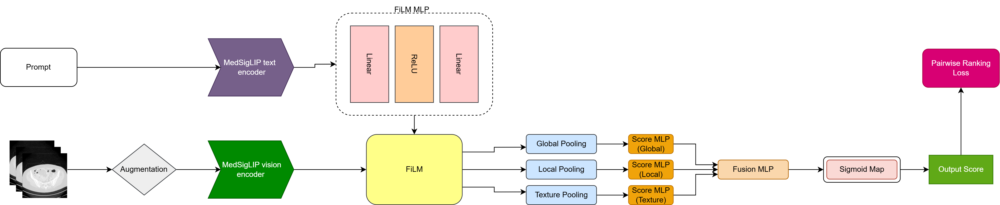
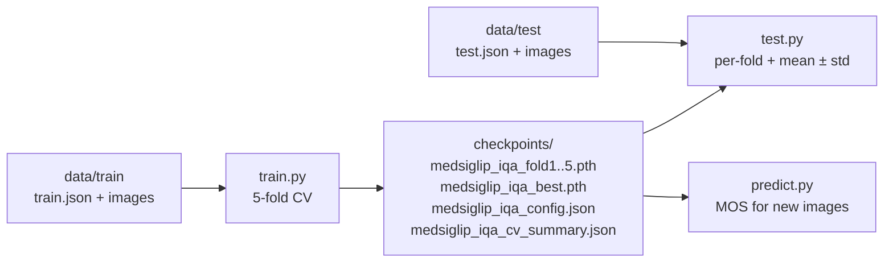

# MedSigLIP for No-Reference Low-Dose CT Quality Assessment: Representation over Architecture, and What the Benchmark Rewards

Official code for a prompt-conditioned MedSigLIP framework for no-reference
image quality assessment (NR-IQA) of low-dose CT (LDCT). Clinical text prompts
are injected into patch-token features via Feature-wise Linear Modulation
(FiLM), the modulated tokens are aggregated by global, local and texture
pooling branches, and the model is trained with a pairwise ranking loss to
predict the Mean Opinion Score (MOS, 0–4) of a CT slice.



_A low-dose CT slice is encoded into 1,024 patch tokens (d = 1,152) by the
MedSigLIP vision encoder. The frozen MedSigLIP text encoder embeds a clinical
prompt, and a FiLM module maps it to per-channel scale γ and shift β. The
modulated tokens are pooled by three parallel branches (global average, local
4-region average, 2-bin max), and the sub-scores are fused by an MLP and
bounded to [0, 4] by a temperature-scaled sigmoid (τ = 2.0)._

## Key Findings

On the LDCTIQA2023 benchmark, multi-seed evaluation (3 seeds × 5 folds) gives
PLCC = 0.9348 ± 0.0086 and Overall = 2.6723 ± 0.0254, at approximately
3rd-place level among the challenge entries. Controlled ablations show where
this performance comes from:

- **Representation, not architecture.** MedSigLIP outperforms EfficientNet-B0
  by +0.0955 Overall and BiomedCLIP by +0.2144; medical-domain fine-tuning
  (MedSigLIP vs. SigLIP, +0.1492) is the clearest single factor.
- **FiLM and pooling add little.** FiLM gives no reliable gain on any backbone
  and modulates only 3–4% of channels, nearly identically across prompts
  (cosine similarity > 0.985). The three pooling branches are near-redundant
  (|ρ| > 0.99), yielding only a within-noise gain.
- **What the benchmark rewards.** A single high-frequency energy scalar
  correlates with radiologist MOS at 98% of the model's own correlation and,
  after a monotone rescaling fitted on the training labels, reaches
  Overall = 2.618, level with the 5th-place entry.

### Intended use and limitations

The model is trained only on noise and streak degradations, and it has a
clinically significant **smoothness bias**: Gaussian-blurred images
(σ = 2.0) score on average +0.93 MOS above their originals, with 0% correct
preference. **It should therefore not be used to rank denoising algorithms.**

## Repository Structure

```
.
├── config.py           # Default configuration and prompts (DEFAULT_PROMPT, RUBRIC_PROMPT)
├── data.py             # Annotation loading, image IO, dataset, transforms, processor
├── model.py            # PromptedMultiScaleMedSigLIPIQA, RankNetMSELoss, checkpoint helpers
├── train.py            # 5-fold cross-validation training
├── test.py             # Test-set evaluation (PLCC, SROCC, KROCC), single or all folds
├── predict.py          # MOS prediction for individual images
├── requirements.txt    # Python dependencies
├── LICENSE             # CC BY-NC 4.0
└── assets/
    └── architecture.png
```

## Installation

1. Clone the repository:
   ```bash
   git clone https://github.com/itu-biai/medsiglip-ldct-iqa.git
   cd medsiglip-ldct-iqa
   ```

2. Create an environment and install dependencies:
   ```bash
   conda create -n medsiglip_ldct_iqa python=3.11
   conda activate medsiglip_ldct_iqa
   pip install -r requirements.txt
   ```

3. Get access to MedSigLIP. `google/medsiglip-448` is a gated model: accept the
   Health AI Developer Foundations terms on its
   [Hugging Face page](https://huggingface.co/google/medsiglip-448), then log in:
   ```bash
   hf auth login
   ```

Tested with Python 3.11, PyTorch 2.11 and Transformers 5.17.

## Dataset

LDCTIQA2023 Challenge: 1,000 training and 300 test images (2D axial slices)
with radiologist-assigned MOS on a 0–4 scale.

- **Training Data:**
  [Zenodo - LDCT-IQA 2023](https://zenodo.org/records/7833096#.ZEFywOxBzn5)
- **Test Data:**
  [Google Drive](https://drive.google.com/file/d/1DbZfTj4it-3QRTuJO73r1iQyHLRwPS6H/view)

Default paths in `config.py` (override with command-line flags):

```
data/
├── train/
│   ├── train.json      # {"0000.tif": 3.2, ...}  filename -> MOS
│   └── image/
└── test/
    ├── test.json
    └── images/
```

## Usage



### Training

```bash
# 5-fold cross-validation with the defaults in config.py
python train.py

# Custom paths / experiment name
python train.py --json data/train/train.json --data-dir data/train/image \
                --checkpoint-dir checkpoints --exp-name medsiglip_iqa

# Train only some folds, or with another prompt
python train.py --folds 3
python train.py --prompt "Assess LDCT image quality." --exp-name short_prompt
```

For each fold, the epoch with the lowest validation loss is saved as
`{exp_name}_fold{k}.pth`, and the best fold is copied to `{exp_name}_best.pth`.
Per-fold best-epoch metrics are written to `{exp_name}_cv_summary.json`, and
the prompt and hyperparameters to `{exp_name}_config.json`. The prompt
embedding is not stored inside the `.pth`; `test.py` and `predict.py` read it
back from `{exp_name}_config.json`, so a checkpoint is always evaluated with
the prompt it was trained with.

### Testing

```bash
# All folds in a directory -> per-fold table, mean ± std, checkpoints/test_results.json
python test.py --ckpt-dir checkpoints --exp-name medsiglip_iqa

# A single checkpoint
python test.py --ckpt checkpoints/medsiglip_iqa_best.pth

# Custom test set and per-image predictions
python test.py --ckpt-dir checkpoints --test-json data/test/test.json \
               --test-dir data/test/images --save-preds predictions.csv
```

Reported metrics: PLCC, SROCC, KROCC and their sum (Overall), following the
challenge protocol.

### Inference

```bash
python predict.py --ckpt checkpoints/medsiglip_iqa_fold3.pth scan1.tif scan2.tif --out predictions.csv
```

## Configuration

All defaults (paths, hyperparameters, prompt, FiLM strength, loss weights) are
in `config.py`; the most common ones can be overridden from the command line
(`python train.py --help`).

### Prompts

The default prompt (`DEFAULT_PROMPT`, ~25 BPE tokens) names the perceptual
dimensions radiologists attend to without enumerating the full rubric:

> Assess LDCT diagnostic image quality using noise, artifacts, contrast,
> sharpness, and anatomical visibility; assign MOS from 0 to 4.

`RUBRIC_PROMPT` holds the detailed-rubric variant. MedSigLIP's text encoder
has a hard 64-token limit.

### Loss

Pure pairwise ranking loss following RankNet with temperature
$\tau_{\mathrm{rank}}=0.5$:

$$\mathcal{L}_{\mathrm{rank}} = \frac{1}{|\mathcal{P}|}\sum_{(i,j)\in\mathcal{P}} \log\left(1+e^{\frac{-s_{ij}(\hat y_i-\hat y_j)}{\tau_{\mathrm{rank}}}}\right)$$

where $\mathcal{P}$ is the set of non-tied pairs and
$s_{ij}=\mathrm{sign}(y_i-y_j)$.

### Implementation note

SigLIP has no CLS token; the model pools patch tokens from the second position
onward (1,023 of the 1,024 tokens). This is kept so that the code matches the
reported runs.

## Results

LDCTIQA2023 test set (300 images), default prompt.

| Method | PLCC | SROCC | KROCC | Overall |
| ------ | ---- | ----- | ----- | ------- |
| **Ours** (3 seeds × 5 folds, mean ± std) | 0.9348 ± 0.009 | 0.9399 ± 0.006 | 0.7975 ± 0.011 | 2.6723 ± 0.025 |
| **Ours** (best fold†) | 0.9578 | 0.9565 | 0.8310 | 2.7453 |
| Challenge 1st place | 0.9491 | 0.9495 | 0.8440 | 2.7427 |
| Challenge 2nd place | 0.9434 | 0.9414 | 0.7995 | 2.6843 |
| Challenge 3rd place | 0.9402 | 0.9387 | 0.7930 | 2.6719 |
| Challenge 4th place | 0.9362 | 0.9338 | 0.7851 | 2.6550 |
| Challenge 5th place | 0.9278 | 0.9232 | 0.7691 | 2.6202 |

† Seed 42, Fold 3: the maximum of 15 test-set evaluations (3 seeds × 5 folds),
an optimistic upper bound rather than a head-to-head comparison. The multi-seed
mean is the primary estimate.

## Pre-trained Weights

- **5-fold checkpoints (default prompt):** will be released upon publication.
- **Preprint checkpoint** ([arXiv:2511.12256](https://arxiv.org/abs/2511.12256)):
  [Google Drive](https://drive.google.com/drive/folders/1ShbXiggqHdVGdCkYe8IK2RKP6vErSogV?usp=sharing).
  It was trained with the detailed-rubric prompt, so set
  `"text_prompt": RUBRIC_PROMPT` in `config.py` before evaluating it:
  ```bash
  python test.py --ckpt best_model.pth
  ```

## License

This project is licensed under the Creative Commons Attribution-NonCommercial
4.0 International License (CC BY-NC 4.0) - see the [LICENSE](LICENSE) file for
details.

## Acknowledgements

- [Google MedSigLIP](https://huggingface.co/google/medsiglip-448) for the
  pretrained medical vision-language model
- [LDCT-IQA Challenge](https://ldctiqac2023.grand-challenge.org/) for the
  dataset

## Contact

For questions and feedback, please open an issue in the GitHub repository.
