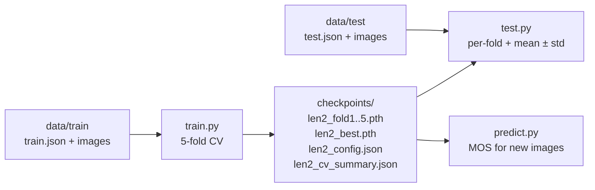

# Prompt-Conditioned FiLM and Multi-Scale Fusion on MedSigLIP for Low-Dose CT Quality Assessment

This project implements a prompt-conditioned framework built on MedSigLIP that
injects textual priors via Feature-wise Linear Modulation (FiLM) and multi-scale
pooling. Text prompts condition patch-token features on clinical intent,
enabling data-efficient learning. The architecture combines global, local, and
texture-aware pooling through separate regression heads fused by a lightweight
MLP, trained with pairwise ranking loss.

## Project Overview

The model predicts Mean Opinion Score (MOS) values (0-4 scale) for low-dose CT
images, enabling automated quality assessment for medical imaging applications.
Key components:

1. **MedSigLIP Backbone** - Medical domain-adapted vision-language model; the
   vision encoder is fine-tuned end-to-end, the text encoder stays frozen
2. **FiLM Prompt Conditioning** - Text-guided feature modulation for
   task-specific adaptation
3. **Multi-Scale Feature Extraction** - Global, local, and texture-level quality
   assessment
4. **Pairwise Ranking Loss** - RankNet-based loss for better correlation metrics

## What's New (v2)

- **New default prompt (`len2`, ~25 tokens)** — the 25–35 token range had the
  highest mean Overall in the prompt-length study (see [Results](#results)).
  The arXiv v1 detailed-rubric prompt is kept as `PAPER_V1_PROMPT` in
  `config.py`.
- **Multi-fold evaluation** — `test.py` evaluates every fold checkpoint and
  reports per-fold results plus mean ± std (or a single checkpoint with
  `--ckpt`).
- **Command-line interface** for `train.py`, `test.py` and the new
  `predict.py` (MOS for arbitrary images).
- **Self-describing runs** — `train.py` writes `{exp}_config.json` (prompt and
  hyperparameters) next to the checkpoints; `test.py`/`predict.py` read it back,
  so a checkpoint is always evaluated with the prompt it was trained with (the
  prompt embedding is not stored inside the `.pth`).
- **Compatibility** with `transformers` 5.x and the `torch.amp` API.
- **Fixes** — the fold summary now reports best-epoch metrics; loading errors,
  unreadable images and failed batches raise instead of silently falling back.
- The checkpoint format is unchanged (plain `state_dict`), so existing
  checkpoints load as before.

## Directory Structure

```
.
├── config.py           # Default configuration and prompts (LEN2_PROMPT, PAPER_V1_PROMPT)
├── data.py             # Annotation loading, image IO, dataset, transforms, processor
├── model.py            # PromptedMultiScaleMedSigLIPIQA, RankNetMSELoss, checkpoint helpers
├── train.py            # 5-fold cross-validation training
├── test.py             # Test-set evaluation (PLCC, SROCC, KROCC), single or all folds
├── predict.py          # MOS prediction for individual images
├── requirements.txt    # Python dependencies
├── LICENSE             # CC BY-NC 4.0
└── assets/
    └── architecture.png
```

## Installation

1. Clone the repository:
   ```bash
   git clone https://github.com/itu-biai/medsiglip-ldct-iqa.git
   cd medsiglip-ldct-iqa
   ```

2. Create an environment and install dependencies:
   ```bash
   conda create -n medsiglip_ldct_iqa python=3.11
   conda activate medsiglip_ldct_iqa
   pip install -r requirements.txt
   ```

3. Get access to MedSigLIP. `google/medsiglip-448` is a gated model: accept the
   Health AI Developer Foundations terms on its
   [Hugging Face page](https://huggingface.co/google/medsiglip-448), then log in:
   ```bash
   hf auth login
   ```

Tested with Python 3.11, PyTorch 2.11 and Transformers 5.17.

## Dataset

The model was trained and evaluated on the LDCTIQA2023 Challenge dataset:

- **Training Data:**
  [Zenodo - LDCT-IQA 2023](https://zenodo.org/records/7833096#.ZEFywOxBzn5)
- **Test Data:**
  [Google Drive](https://drive.google.com/file/d/1DbZfTj4it-3QRTuJO73r1iQyHLRwPS6H/view)

Default paths in `config.py` (override with command-line flags):

```
data/
├── train/
│   ├── train.json      # {"0000.tif": 3.2, ...}  filename -> MOS
│   └── image/
└── test/
    ├── test.json
    └── images/
```

## Usage



### Training

```bash
# 5-fold cross-validation with the defaults in config.py
python train.py

# Custom paths / experiment name
python train.py --json data/train/train.json --data-dir data/train/image \
                --checkpoint-dir checkpoints --exp-name len2

# Train only some folds, or with another prompt
python train.py --folds 3
python train.py --prompt "Assess LDCT image quality." --exp-name short_prompt
```

For each fold, the epoch with the lowest validation loss is saved as
`{exp}_fold{k}.pth`. The best fold (lowest `select_metric`, validation loss by
default) is copied to `{exp}_best.pth`. Per-fold best-epoch metrics (loss, MAE,
RMSE, Pearson) are written to `{exp}_cv_summary.json`.

### Testing

```bash
# All folds in a directory -> per-fold table, mean ± std, checkpoints/test_results.json
python test.py --ckpt-dir checkpoints --exp-name len2

# A single checkpoint
python test.py --ckpt checkpoints/len2_best.pth

# Custom test set and per-image predictions
python test.py --ckpt-dir checkpoints --test-json data/test/test.json \
               --test-dir data/test/images --save-preds predictions.csv
```

The test script reports the challenge metrics:

- **PLCC**: Pearson Linear Correlation Coefficient
- **SROCC**: Spearman Rank Order Correlation Coefficient
- **KROCC**: Kendall Rank Order Correlation Coefficient
- **Overall**: PLCC + SROCC + KROCC

### Inference

```bash
python predict.py --ckpt checkpoints/len2_fold3.pth scan1.tif scan2.tif --out predictions.csv
```

## Configuration

All defaults live in `config.py`; the most important ones:

| Key | Default | Description |
| --- | --- | --- |
| `model_name` | `google/medsiglip-448` | Backbone |
| `image_size` | `448` | Input resolution |
| `text_prompt` | `LEN2_PROMPT` | Prompt injected via FiLM |
| `film_strength` | `1.0` | FiLM strength *s* (0 = off) |
| `text_freeze` / `freeze_backbone` | `True` / `False` | Freeze text / vision encoder |
| `sigmoid_tau` | `2.0` | Output sigmoid temperature |
| `bound_output_0_4` | `True` | Map output to [0, 4] |
| `learning_rate` / `weight_decay` | `1e-5` / `1e-4` | AdamW |
| `batch_size` × `grad_accum_steps` | `4` × `2` | Effective batch size 8 |
| `num_epochs` | `22` | Epochs per fold |
| `T_max` / `eta_min` | `100` / `1e-7` | Cosine annealing |
| `use_amp` | `True` | Mixed precision |
| `num_folds` / `seed` | `5` / `42` | Cross-validation |
| `rank_weight` / `mse_weight` / `rank_tau` | `1.0` / `0.0` / `0.5` | Loss (pure pairwise ranking) |
| `select_metric` | `val_loss` | Best-fold selection (`mae` in arXiv v1) |
| `early_stop_patience` | `None` | Early stopping (disabled) |

### Prompts

The default prompt (`LEN2_PROMPT`, ~25 BPE tokens):

> Assess LDCT diagnostic image quality using noise, artifacts, contrast,
> sharpness, and anatomical visibility; assign MOS from 0 to 4.

MedSigLIP's text encoder has a hard 64-token limit. To reproduce the arXiv v1
setup, set `"text_prompt": PAPER_V1_PROMPT` and `"select_metric": "mae"` in
`config.py`.

## Model Architecture

### PromptedMultiScaleMedSigLIPIQA


_Figure: Prompt-conditioned FiLM with multi-scale (global/local/texture)
pooling._

The MedSigLIP vision encoder turns a 448×448 slice into 32×32 = 1,024 patch
tokens (d = 1,152). The frozen text encoder embeds the prompt, and a two-layer
MLP maps it to FiLM parameters (γ, β) that modulate the tokens:
$\tilde{H} = H \odot (1 + s\tanh\gamma) + s\beta$. Three pooling branches
(global average, 4-region average, 2-bin max) feed separate regression heads,
whose sub-scores are fused by an MLP and mapped to [0, 4] via
$\hat{y} = 4\sigma(\mathrm{logit}/\tau)$. The implementation pools tokens from
the second position onward (1,023 tokens); this is kept so the code matches the
reported runs.

### Loss Function (Pairwise Ranking Loss)

We use pure pairwise ranking loss following RankNet with temperature
$\tau_{\mathrm{rank}}=0.5$:

$$\mathcal{L}_{\mathrm{rank}} = \frac{1}{|\mathcal{P}|}\sum_{(i,j)\in\mathcal{P}} \log\left(1+e^{\frac{-s_{ij}(\hat y_i-\hat y_j)}{\tau_{\mathrm{rank}}}}\right)$$

where $\mathcal{P}$ is the set of non-tied pairs and
$s_{ij}=\mathrm{sign}(y_i-y_j)$.

## Results

LDCTIQA2023 test set (300 images), default `len2` prompt. Numbers are from the
extended version of the paper (under review).

| Method | PLCC | SROCC | KROCC | Overall |
| ------ | ---- | ----- | ----- | ------- |
| **Ours** (3 seeds × 5 folds, mean ± std) | 0.9348 ± 0.009 | 0.9399 ± 0.006 | 0.7975 ± 0.011 | 2.6723 ± 0.025 |
| **Ours** (best fold†) | 0.9578 | 0.9565 | 0.8310 | 2.7453 |
| Challenge 1st place | 0.9491 | 0.9495 | 0.8440 | 2.7427 |
| Challenge 2nd place | 0.9434 | 0.9414 | 0.7995 | 2.6843 |
| Challenge 3rd place | 0.9402 | 0.9387 | 0.7930 | 2.6719 |
| Challenge 4th place | 0.9362 | 0.9338 | 0.7851 | 2.6550 |
| Challenge 5th place | 0.9278 | 0.9232 | 0.7691 | 2.6202 |

† Seed 42, Fold 3: the maximum of 15 test-set evaluations (3 seeds × 5 folds),
an optimistic upper bound rather than a head-to-head comparison. The multi-seed
mean is the primary estimate.

**Per-fold results (Seed 42):**

| Fold | PLCC | SROCC | KROCC | Overall |
| ---- | ---- | ----- | ----- | ------- |
| 1 | 0.9404 | 0.9463 | 0.8124 | 2.6991 |
| 2 | 0.9351 | 0.9426 | 0.8023 | 2.6801 |
| 3 | **0.9578** | **0.9565** | **0.8310** | **2.7453** |
| 4 | 0.9477 | 0.9451 | 0.8069 | 2.6996 |
| 5 | 0.9346 | 0.9387 | 0.7950 | 2.6682 |
| Mean ± std | 0.9431 ± 0.009 | 0.9459 ± 0.006 | 0.8095 ± 0.012 | 2.6985 ± 0.026 |

**Prompt length (Seed 42, 5 folds, mean ± std):**

| Tokens | PLCC | SROCC | KROCC | Overall |
| ------ | ---- | ----- | ----- | ------- |
| 5–15 | 0.9417 ± 0.006 | 0.9447 ± 0.003 | 0.8054 ± 0.006 | 2.6918 ± 0.013 |
| **25–35 (default)** | **0.9431 ± 0.009** | **0.9459 ± 0.006** | **0.8095 ± 0.012** | **2.6985 ± 0.026** |
| 55–65 | 0.9366 ± 0.011 | 0.9423 ± 0.006 | 0.8017 ± 0.011 | 2.6806 ± 0.026 |
| > 100 | N/A (exceeds the 64-token limit) | | | |

The three valid lengths span only 0.0179 Overall, so they are not separable at
this precision.

**arXiv v1** (detailed-rubric prompt, single best fold selected by validation
MAE): PLCC 0.9575, SROCC 0.9561, KROCC 0.8301, Overall 2.7436.

## Pre-trained Weights

- **`len2` 5-fold checkpoints:** coming soon.
- **arXiv v1 checkpoint:**
  [Google Drive](https://drive.google.com/drive/folders/1ShbXiggqHdVGdCkYe8IK2RKP6vErSogV?usp=sharing).
  It was trained with the detailed-rubric prompt, so set
  `"text_prompt": PAPER_V1_PROMPT` in `config.py` before using it:
  ```bash
  python test.py --ckpt best_model.pth
  ```

## License

This project is licensed under the Creative Commons Attribution-NonCommercial
4.0 International License (CC BY-NC 4.0) - see the [LICENSE](LICENSE) file for
details.

## Citation

If you use this code in your research, please consider citing:

```bibtex
@article{demiroglu2025prompt,
  title={Prompt-Conditioned FiLM and Multi-Scale Fusion on MedSigLIP for Low-Dose CT Quality Assessment},
  author={Demiroglu, Tolga and Unal, Mehmet Ozan and Ertas, Metin and Yildirim, Isa},
  journal={arXiv preprint arXiv:2511.12256},
  year={2025}
}
```

## Acknowledgements

- [Google MedSigLIP](https://huggingface.co/google/medsiglip-448) for the
  pretrained medical vision-language model
- [LDCT-IQA Challenge](https://ldctiqac2023.grand-challenge.org/) for the
  dataset

## Contact

For questions and feedback, please open an issue in the GitHub repository.
